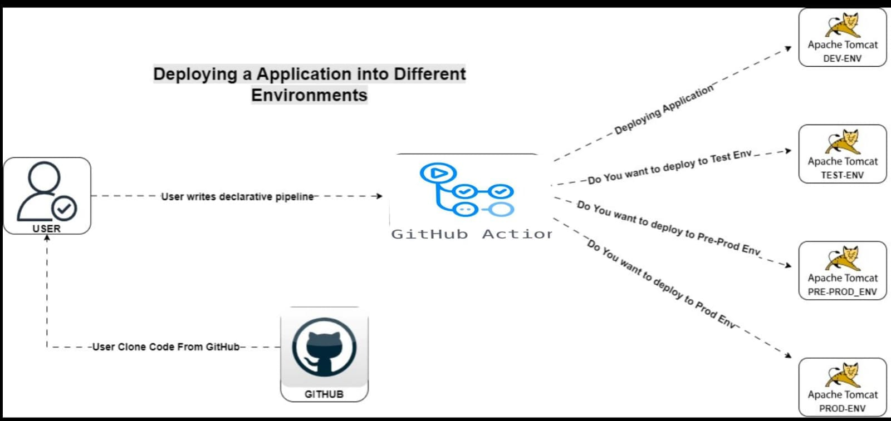
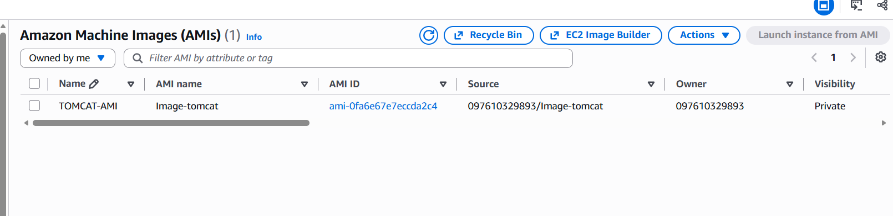
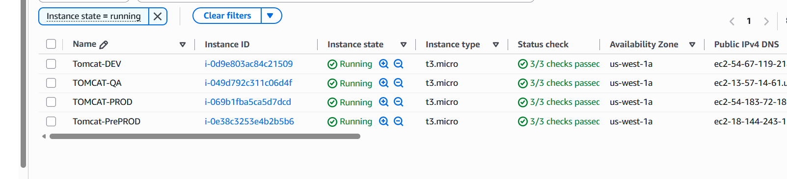
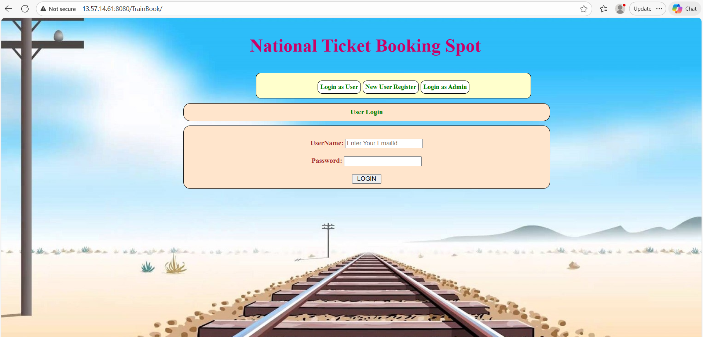
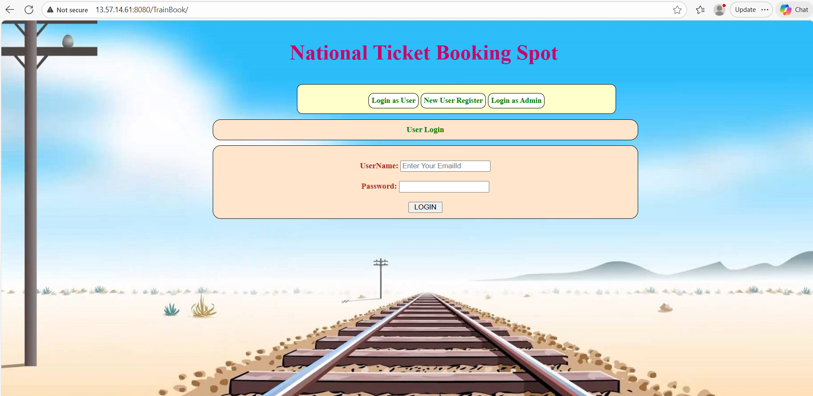
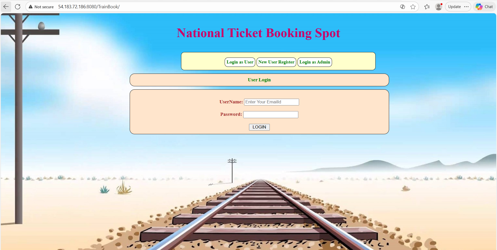

# Multi‑Environment CI/CD Deployment for TOMCAT

## Workflow Summary

- **Trigger:** Runs automatically on every push to the `master` branch.  
- **Build Stage:**
  - Checkout source code.  
  - Set up **Java 17 (Temurin distribution)**.  
  - Run Maven lifecycle: `validate`, `compile`, `test`, `package`.  
  - Upload the generated WAR file as an artifact.  
- **Deployment Stages:**
  - Each environment downloads the artifact.  
  - Deploys to Tomcat via **Manager API** using `curl`.  
  - Credentials and host details are securely stored in **GitHub Secrets**.  
  - Higher environments (PrePROD, PROD) require manual approval via **GitHub → Settings → Environments**.

## 2. Architecture



## 3. Environment configuration

**Repository → Settings → Environments**

  GitHub Environment   Purpose                     Approval
  -------------------- --------------------------- ----------------------
  `dev`                Development deployment      No required reviewer
  `test`               Test deployment             Required reviewers
  `preprod`            Pre-production validation   Required reviewers
  `prod`               Production deployment       Required reviewers

### 3.1 Environment Secrets

Configure the following variables separately in each Environment:

| Environment | Secret Name             | Purpose                          | Example Value                |
|-------------|-------------------------|----------------------------------|------------------------------|
| **DEV**     | `DEV_TOMCAT_USER`       | Tomcat Manager username          | `admin`                      |
|             | `DEV_TOMCAT_PASSWORD`   | Tomcat Manager password          | `prathap123`                 |
|             | `DEV_TOMCAT_HOST`       | EC2 host IP/DNS                  | `13.57.14.61`                |
| **QA**      | `QA_TOMCAT_USER`        | Tomcat Manager username          | `admin`                      |
|             | `QA_TOMCAT_PASSWORD`    | Tomcat Manager password          | `prathap123`                 |
|             | `QA_TOMCAT_HOST`        | EC2 host IP/DNS                  | `54.67.119.218`              |
| **PREPROD** | `PREPROD_TOMCAT_USER`   | Tomcat Manager username          | `admin`                      |
|             | `PREPROD_TOMCAT_PASSWORD` | Tomcat Manager password        | `prathap123`                 |
|             | `PREPROD_TOMCAT_HOST`   | EC2 host IP/DNS                  | `13.57.14.61`                |
| **PROD**    | `PROD_TOMCAT_USER`      | Tomcat Manager username          | `admin`                      |
|             | `PROD_TOMCAT_PASSWORD`  | Tomcat Manager password          | `prathap123`                 |
|             | `PROD_TOMCAT_HOST`      | EC2 host IP/DNS                  | `54.183.72.186`              |

## 4 EC2 and AMI Configuration
### 4.1 EC2 & Tomcat Install for DEV environment:

## EC2 Configuration

### AMI
- **Ubuntu 22.04 LTS**

### Instance Type
- **t2.micro** (for testing and lightweight workloads)

### Security Group
Open the following ports:
- **22 → SSH** (remote access)
- **8080 → Tomcat** (web application access)

### Tomcat deployment and validation  

```bash
sudo -i                                                                                   # To become a root use
apt update -y                                                                             # Upgrading packages.
apt install default-jdk -y                                                                # Install the default java application
java --version                                                                            # Check java installed
wget https://dlcdn.apache.org/tomcat/tomcat-9/v9.0.123/bin/apache-tomcat-9.0.123.tar.gz   # Install TOMCAT
tar -xf apache-tomcat-9.0.123.tar.gz                                                      # Extract files from a tar archive
mv apache-tomcat-9.0.12 tomcat                                                            # Rename the file
~/tomcat/webapps/host-manager/META-INF#                                                   # Navigate to META-INF Folder
vim context.xml                                                                           # open file called context.xml
<!--
<Valve className="org.apache.catalina.valves.RemoteAddrValve"                             # Comment out or remove this line for both manager and host-manager
       allow="127.0.0./8::1/128"/> -->                                                    # By default, Tomcat restricts Manager access to localhost
<role rolename="manager-gui"/>
<user username="tomcat" password="s3cret" roles="manager-gui"/>                           # Defined a user with the correct roles
<role rolename="manager-script"/>
<user username="prathap123" password="prathap123" roles="manager-script"/>                # Defined a user with the correct roles
<role rolename="admin-gui"/>
<user username="admin" password="admin123" roles="admin-gui"/>
~/tomcat/bin# ./shutdown.sh                                                               # Shutdown tomcat 
~/tomcat/bin# ./shartup.sh                                                                # Start the Tomcat
54.18372.186:8080/TrainBook/                                                              # Search in URL
```

### Creating the AMI:
Follow these steps to prepare and create a reusable Amazon Machine Image (AMI) from the DEV environment.
#### Steps

1. **Validate Services on DEV**
   - Confirm Tomcat is running and accessible.
   - Verify SSH login works with the `deploy` user.
   - Test deployment permissions (upload WAR via Tomcat Manager).
   - Ensure service restart (`systemctl restart tomcat10`) works without issues.

2. **Run Provisioning Script in `prepare-ami` Mode**
   - Execute the provisioning script with the `prepare-ami` flag.
   - This cleans up environment‑specific data and prepares the instance for image creation.

3. **Confirm SSH Host Key Cleanup**
   - Verify that instance‑specific SSH host keys have been removed.
   - This ensures the AMI is reusable and avoids conflicts when launching new instances.

4. **Stop DEV Instance and Create AMI**
   - Shut down the DEV EC2 instance.
   - From the AWS Console or CLI, create an AMI from the stopped instance.
   - Tag the AMI appropriately (e.g., `TrainBook-Base-AMI`) for easy identification.

   
  ### Screenshot of AMI used for different environment




### 5. The creation of four EC2 instances for different environments (DEV, QA, PrePROD, PROD)

  1. use AMI created from DEV for all QA, Prep prod and Prod
  2. launch remaining three instances with own AMI
  3. Check all configuration setup in the instances, security groups and tomcat secrets
### EC2 instances for different environments:


### 6. DEV environment deployment output:


### 7. QA environment deployment output:


### 8. Pre PROD environment deployment output:


### 9. PROD environment deployment output:



  


  

